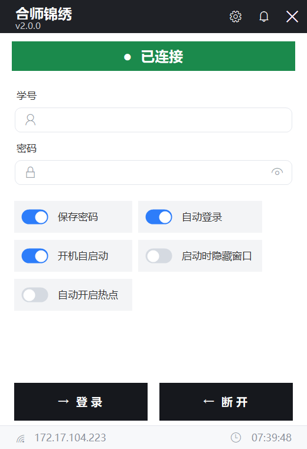

# 合肥师范学院 锦绣校区 校园网自动登录

一个常驻托盘、无人值守的 Windows 校园网自动登录工具。开机自动醒来 → 检查网络 → 掉线立即重新认证。

> **仅适用于合肥师范学院锦绣校区。**
>
> 认证服务器为 `192.168.1.100`，协议为华为 **ePortal (ACSetting)** Web Portal。
> 其他校区、其他学校的认证地址与协议参数均不相同，**直接拿去用不会有任何效果**。



---

## 适用范围

| 项 | 值 |
|---|---|
| 学校 | 合肥师范学院（HFNU） |
| 校区 | **锦绣校区** |
| 认证服务器 | `192.168.1.100:801` |
| 协议 | 华为 ePortal (ACSetting) |

> ⚠️ 不要在合肥师范学院其他校区使用，也不要用于其他学校 —— 参数对不上，程序不会工作。

---

## 功能

| 层级 | 功能 |
|---|---|
| **核心** | 开机自启（任务计划，延迟 30s）· DPAPI 加密记住账号 · 自动登录 · 隐藏式启动 |
| **支撑** | 连通性探测 · 掉线重连 · 休眠唤醒恢复 · 网络事件监听 · 失败重试 · 单实例 · 日志 |
| **体验** | 托盘状态图标 · 右键菜单 · 设置窗口 · 首次运行引导 |
| **增强** | 一键注销 · 自启开关 · 检测间隔可调 · 登录成功通知 |

---

## 下载

前往 [Releases](https://github.com/Tangmastrain/HFNUAutoLogin/releases/latest) 下载 `HFNUAutoLogin-fd-win-x64.zip`。

**框架依赖版**（推荐，6.8 MB）—— 解压后运行 `CampusAutoLogin2.0.exe`。

> **需要 .NET 8 Desktop Runtime**。没有的话：
> - 命令行一键装：`winget install Microsoft.DotNet.DesktopRuntime.8`
> - 或手动下载：<https://dotnet.microsoft.com/download/dotnet/8.0>（选 **Desktop Runtime** x64）

### 想要免安装运行时的版本？

自己构建自包含单文件版（约 75 MB，无需任何运行时）：

```bash
dotnet publish CampusAutoLogin2.0/CampusAutoLogin2.0.csproj \
  -c Release -r win-x64 \
  --self-contained true \
  -p:PublishSingleFile=true \
  -p:IncludeNativeLibrariesForSelfExtract=true \
  -p:EnableCompressionInSingleFile=true \
  -o CampusAutoLogin2.0/publish
```

> `EnableCompressionInSingleFile` 可把单文件从 ~180 MB 压到 ~75 MB，务必带上。

需要 .NET 8 SDK。

> 系统要求：Windows 10 1809 (build 17763) 或更高。

---

## 使用

1. 双击运行，首次会弹出设置窗口
2. 填入校园网账号密码（用 DPAPI 加密存到本地，不落明文）
3. 按需开启「开机自启」
4. 之后它就在托盘里待着，掉线自动重连

配置与日志位置：`%APPDATA%\CampusAutoLogin2.0\`

### 权限说明

程序**请求以管理员身份运行**（清单 `requireAdministrator` 已编译进 exe）：创建「免登录开机自启」计划任务需要管理员权限。

- 需求随 exe 走 —— 换目录、换机器都自带，无需再手工设置「以管理员身份运行」
- 若 UAC 弹窗，请点「是」；若账户不在 Administrators 组，会自动回退为「登录后运行」

---

## 安全说明

本程序以**密码明文**方式提交到校园网 ePortal 认证接口（服务端要求，`enMd5=0`）。
因此：

- 所有网络请求**仅限合肥师范学院锦绣校区内网**（`192.168.1.100`），不经过任何第三方
- 账号密码本地使用 **Windows DPAPI** 加密存储，绑定当前用户
- 程序不含任何遥测、上报、外传逻辑

---

## 从源码构建

```bash
# 框架依赖版（体积小，需 .NET 8 Desktop Runtime）
dotnet publish CampusAutoLogin2.0/CampusAutoLogin2.0.csproj \
  -c Release -r win-x64 --self-contained false -o out

# 自包含单文件版（约 75 MB，免运行时）
dotnet publish CampusAutoLogin2.0/CampusAutoLogin2.0.csproj \
  -c Release -r win-x64 --self-contained true \
  -p:PublishSingleFile=true \
  -p:IncludeNativeLibrariesForSelfExtract=true \
  -p:EnableCompressionInSingleFile=true -o out
```

需要 .NET 8 SDK。

---

## 目录结构

```
CampusAutoLogin2.0/
├── Auth/          # 认证协议实现（ePortal ACSetting）
├── Core/          # 协调器、连通性监控、重试策略
├── Platform/      # 自启、托盘图标、热管理、日志
├── Storage/       # DPAPI 凭据存储、配置持久化
├── UI/            # 主窗口、设置窗口、托盘菜单、主题
└── tools/         # 图标生成脚本
```

---

## 免责声明

**本工具仅面向合肥师范学院锦绣校区的师生**，用于在已获授权的校园网络内自动完成登录认证。

请在遵守学校网络使用规定的前提下使用。*未经授权，不得用于其他学校或校区的网络。*
